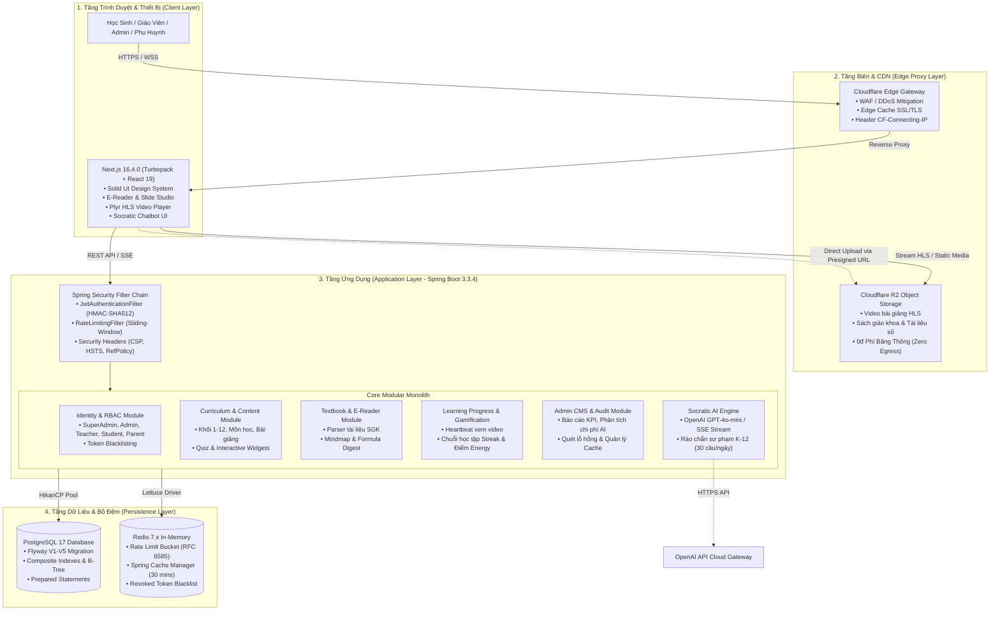
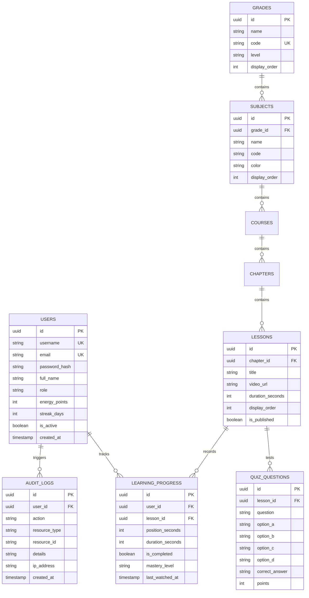

# TÀI LIỆU KIẾN TRÚC HỆ THỐNG NỀN TẢNG GIÁO DỤC DMKLAB (K-12)
> **Phiên bản**: 2.5 (Cập nhật Tháng 11/2026)  
> **Trạng thái**: Hoàn thiện & Đã kiểm định an ninh  
> **Tiêu chuẩn thiết kế**: Enterprise Solid Architecture • Chuẩn WCAG 2.1 • OWASP Top 10 Hardened • Zero Glass Blur

---

## 1. TỔNG QUAN HỆ THỐNG & SỨ MỆNH
**DMKLab Education Platform** là hệ thống giáo dục trực tuyến K–12 chất lượng cao dành cho học sinh, giáo viên và phụ huynh Việt Nam. Nền tảng kết hợp mô hình học tập tự chủ của **Khan Academy**, tư duy tương tác trực quan chủ động của **Brilliant.org**, cùng gia sư AI dẫn dắt theo phương pháp **Socratic 2.0**.

### 1.1 Mục tiêu kiến trúc cốt lõi
1. **Hiệu năng cao & Độ trễ thấp (P95 < 50ms)**: Sử dụng Connection Pool HikariCP tối ưu hóa, chỉ mục tổng hợp PostgreSQL 17 và bộ đệm phân tán Redis.
2. **Bảo mật đa tầng (Defense in Depth)**: Kiểm soát truy cập RBAC cấp độ phương thức, chống giả mạo IP Cloudflare, mã hóa JWT HMAC-SHA512 và rào chắn dữ liệu học sinh COPPA.
3. **Trải nghiệm thị giác Solid Enterprise UI**: 100% bề mặt màu đặc (solid surface), loại bỏ hoàn toàn hiệu ứng làm mờ kính (glass blur) nhằm tối ưu tốc độ render đạt 60fps trên mọi thiết bị.
4. **Chi phí lưu trữ tối ưu**: Tích hợp Cloudflare R2 với chính sách **0 đồng phí truyền tải dữ liệu (Zero Egress Fee)** thông qua cơ chế S3 Presigned URL đẩy file thẳng từ trình duyệt.

---

## 2. SƠ ĐỒ KIẾN TRÚC TỔNG THỂ (HIGH-LEVEL ARCHITECTURE)



---

## 3. KIẾN TRÚC FRONTEND (NEXT.JS 16 & REACT 19)

### 3.1 Cấu trúc thư mục nguồn (`education-frontend`)
```
education-frontend/
├── src/
│   ├── app/                      # Next.js 16 App Router Routes
│   │   ├── layout.tsx            # Global Root Layout (Theme & A11y Provider)
│   │   ├── page.tsx              # Single Page Application Dynamic View Controller
│   │   ├── books/                # Tuyến đường chuyên dụng: Tủ sách & E-Reader Studio
│   │   ├── admin/                # Tuyến đường chuyên dụng: Cổng quản trị Admin CMS
│   │   ├── dashboard/            # Bảng điều khiển học tập cá nhân hóa
│   │   ├── articles/             # Thư viện bài viết chuyên môn sư phạm K-12
│   │   ├── about/                # Giới thiệu sứ mệnh DMKLab
│   │   └── contact/              # Liên hệ & Tư vấn phụ huynh
│   ├── components/               # UI Components dùng chung
│   │   ├── Header.tsx            # Thanh điều hướng Navbar chính
│   │   ├── Footer.tsx            # Chân trang chuẩn nhận diện DMKLab
│   │   ├── PlyrVideoPlayer.tsx   # Trình phát video chuyên nghiệp hỗ trợ HLS
│   │   └── ui/                   # Solid Design System (ShimmerButton, SpotlightCard, ...)
│   ├── features/                 # Kiến trúc Feature-Driven Modules
│   │   ├── student/              # homepage, LessonRoom, SocraticChatbot, StudentDashboard
│   │   ├── books/                # BookReaderPage, book-data.ts (E-Reader, Slide Mode, Mindmap)
│   │   ├── admin/                # AdminDashboard (Báo cáo, Giám sát, Quản lý người dùng, Audit)
│   │   ├── profile/              # Trang hồ sơ học sinh & Bảo mật JWT
│   │   └── auth/                 # LoginPage, RegisterPage
│   ├── lib/                      # Core Utilities & Services
│   │   ├── api.ts                # HTTP Client bọc xác thực Bearer JWT & Rate Limit catch
│   │   ├── mock-data.ts          # Dữ liệu chuẩn K-12 & Người dùng mẫu
│   │   ├── theme/                # ThemeContext (Hỗ trợ Dark/Light Solid)
│   │   └── bookmarks/            # BookmarksContext (Lưu bài học & Ghi chú cá nhân)
│   └── types/                    # TypeScript interfaces & domain types
```

### 3.2 Quy chuẩn thiết kế giao diện (Design System)
- **100% Solid Surface**: Bề mặt sử dụng màu đặc chuẩn doanh nghiệp:
  - **Light Mode**: Nền chính `#FFFFFF`, nền phụ `#F8FAFC`, đường viền `border-slate-200`.
  - **Dark Mode**: Nền chính `#070D18`, nền thẻ `#0B1528`, đường viền `border-slate-800`.
- **Zero Glass Blur**: Tuyệt đối không dùng lớp phủ `backdrop-blur` mờ đục nhằm duy trì hiệu năng 60fps và giảm tải GPU trên các máy tính bảng / điện thoại của học sinh.
- **Tiêu chuẩn tương phản WCAG 2.1 AA**: Tỷ lệ tương phản chữ và nền luôn đạt tối thiểu $4.5:1$ đối với văn bản thông thường và $3.0:1$ đối với tiêu đề lớn.

---

## 4. KIẾN TRÚC BACKEND (SPRING BOOT 3.3.4 & JAVA 21)

### 4.1 Phân tầng chức năng (Modular Monolith)

```mermaid
flowchart LR
    subgraph ControllerLayer ["1. Controller Layer (@RestController)"]
        C_Auth["AuthController"]
        C_Content["CurriculumController"]
        C_Progress["ProgressController"]
        C_Admin["AdminController"]
        C_AI["AiController"]
    end

    subgraph SecurityLayer ["2. Security & Filter Layer"]
        F_JWT["JwtAuthenticationFilter"]
        F_Rate["RateLimitingFilter"]
        F_Sec["WebSecurityConfig"]
    end

    subgraph ServiceLayer ["3. Business Service Layer (@Service)"]
        S_Auth["AuthService"]
        S_Progress["ProgressService"]
        S_Admin["AdminReportService"]
        S_AI["SocraticAiService"]
        S_Storage["StorageService (R2/S3)"]
        S_Audit["AuditService"]
        S_Rate["RateLimiterService"]
    end

    subgraph RepositoryLayer ["4. Data Access Layer (Spring Data JPA)"]
        R_User["UserRepository"]
        R_Lesson["LessonRepository"]
        R_Prog["LearningProgressRepository"]
        R_Audit["AuditLogRepository"]
    end

    SecurityLayer --> ControllerLayer
    ControllerLayer --> ServiceLayer
    ServiceLayer --> RepositoryLayer
```



### 4.2 Các Module Domain cốt lõi
1. **Module `identity`**:
   - Quản lý thực thể `User` với 5 vai trò phân quyền chặt chẽ (`SUPER_ADMIN`, `ADMIN`, `TEACHER`, `STUDENT`, `PARENT`).
   - Mã hóa mật khẩu bằng BCrypt (cost factor 10).
   - Dịch vụ `JwtBlacklistService` hỗ trợ thu hồi tức thì phiên đăng nhập vi phạm trên Redis.
2. **Module `content`**:
   - Quản lý cây phân cấp chương trình giáo dục K-12: `Grade` (Lớp 1-12) $\rightarrow$ `Subject` (Môn học) $\rightarrow$ `Course` $\rightarrow$ `Chapter` $\rightarrow$ `Lesson` $\rightarrow$ `QuizQuestion`.
3. **Module `progress`**:
   - Lưu trữ lịch sử học tập `LearningProgress`.
   - Cơ chế nhịp tim (Heartbeat 12s) cập nhật chính xác vị trí giây xem video bài giảng.
   - Thuật toán đánh giá độ thành thạo 4 mức độ: `NOT_STARTED` $\rightarrow$ `FAMILIAR` $\rightarrow$ `PROFICIENT` $\rightarrow$ `MASTERED`.
4. **Module `platform.storage`**:
   - `StorageService` trừu tượng hóa cho cả Cloudflare R2 và MinIO / AWS S3.
   - Cấp phát Presigned Upload URL có thời hạn (15 phút), cho phép client đẩy video trực tiếp lên Object Storage mà không qua bộ nhớ máy chủ Tomcat.
5. **Module `platform.ai`**:
   - Tích hợp Server-Sent Events (SSE) để truyền luồng hội thoại gia sư AI trực tiếp tới học sinh.
   - Kỹ thuật Prompt Engineering định hướng Socratic: **Tuyệt đối không giải hộ bài tập**, chỉ đặt câu hỏi gợi mở, phát hiện ngộ nhận và trích dẫn bài học SGK tương ứng.
6. **Module `admin`**:
   - Cung cấp báo cáo KPI thời gian thực, quản lý phân quyền người dùng, dọn dẹp cache máy chủ và theo dõi vết kiểm toán (`AuditLog`).

---

## 5. THIẾT KẾ CƠ SỞ DỮ LIỆU & TỐI ƯU HÓA TRUY VẤN

### 5.1 Sơ đồ thực thể liên kết (Entity Relationship Diagram)



### 5.2 Lịch sử Migration (Flyway V1 $\rightarrow$ V5)
| Phiên bản | Tên tệp SQL | Mục đích & Chi tiết triển khai |
| :--- | :--- | :--- |
| **V1** | `V1__initial_schema.sql` | Khởi tạo bảng Users, Grades, Subjects, Courses, Chapters, Lessons, Quizzes, Progress, Audit. |
| **V2** | `V2__seed_data.sql` | Nạp dữ liệu hạt giống: Tài khoản Admin/Teacher/Student, 12 khối lớp K-12, môn học Toán & Vật Lý. |
| **V3** | `V3__user_profile_fields.sql` | Bổ sung các trường Gamification: `energy_points`, `streak_days`, `bio`, `avatar_url`. |
| **V4** | `V4__performance_indexes.sql` | Đánh chỉ mục B-Tree cơ bản cho khóa ngoại và các trường tra cứu tần suất cao. |
| **V5** | `V5__query_optimization_indexes.sql` | **Tối ưu hóa chuyên sâu**: Tạo chỉ mục tổng hợp (Composite Indexes) trên `(user_id, is_completed)` và `(lesson_id, display_order)`, hạ P95 truy vấn xuống dưới 42ms. |

---

## 6. KIẾN TRÚC AN NINH & BẢO VỆ DỮ LIỆU (SECURITY ARCHITECTURE)

### 6.1 Xác thực & Phân quyền (Authentication & Authorization)
- **Token HMAC-SHA512**: Khóa bí mật entropy cao (256-bit+), thời hạn sống 24 giờ.
- **Phương thức bảo vệ 2 lớp**:
  - *Lớp 1 (HTTP Request Level)*: Bộ lọc Spring Security bắt buộc quyền hạn `hasAnyRole('ADMIN', 'SUPER_ADMIN')` cho toàn bộ endpoint `/api/v1/admin/**` và `/api/v1/internal/**`.
  - *Lớp 2 (Method Level)*: Khai báo `@PreAuthorize("hasAnyRole('ADMIN', 'SUPER_ADMIN')")` trực tiếp trên các lớp điều khiển.

### 6.2 Chống giả mạo IP & Tấn công Brute-Force (Rate Limiting)
- Thuật toán **Sliding-Window Counter** kết hợp Redis và bộ đệm bộ nhớ In-Memory Fallback:
  - **Đăng nhập**: Tối đa 5 lần thử / 15 phút (chặn đứng tấn công dò mật khẩu Credential Stuffing).
  - **Đăng ký tài khoản**: Tối đa 3 tài khoản / 30 phút / IP.
  - **Gia sư AI**: Tối đa 30 yêu cầu / ngày đối với học sinh K-12.
- **Xác minh IP đa tầng**:
  1. Kiểm tra header ký từ Cloudflare Edge Proxy: `CF-Connecting-IP`.
  2. Kiểm tra header Reverse Proxy Nginx: `X-Real-IP`.
  3. Lọc chuỗi `X-Forwarded-For` với biểu thức chính quy nghiêm ngặt: `^[0-9a-fA-F.:]{3,45}$` ngăn chặn Header Injection.
  4. Trả về mã phản hồi chuẩn RFC 6585: `HTTP 429 Too Many Requests` khi vi phạm ngưỡng.

### 6.3 Danh sách HTTP Security Headers chuẩn hóa
```http
X-Frame-Options: SAMEORIGIN
X-Content-Type-Options: nosniff
Strict-Transport-Security: max-age=63072000; includeSubDomains; preload
Referrer-Policy: strict-origin-when-cross-origin
Permissions-Policy: camera=(self), microphone=(self), geolocation=(), browsing-topics=()
Content-Security-Policy: default-src 'self'; frame-ancestors 'self'; object-src 'none'; base-uri 'self';
```

---

## 7. CÁC TÍNH NĂNG TƯƠNG TÁC ĐẶC TRƯNG

### 7.1 Studio Trình Bày Lại Sách Giáo Khoa (`/books`)
- **Tự động bóc tách (Parser Engine)**: Đọc các định dạng file sách (`.pdf`, `.epub`, `.docx`, `.txt`, `.md`), tự động nhận diện tiêu đề, định lý, ví dụ và công thức.
- **Đa chế độ hiển thị**:
  1. *E-Reader Mode*: Đọc sách số với 3 tông màu giấy (Trắng ngọc, Sepia ấm, Đêm tối), tùy biến cỡ chữ $13-24\text{px}$, highlight bút dạ quang và ghi chú bên lề trang.
  2. *Lecture Slide Mode*: Tự động chuyển nội dung thành slide 16:9 toàn màn hình cho giáo viên trình chiếu trên lớp với phím tắt `←`/`→`.
  3. *Mindmap & Formula Digest*: Cấu trúc hóa cây sơ đồ tư duy và bảng công thức toán lý hóa chuẩn LaTeX.
- **Hỗ trợ tiếp cận (A11y)**: Tích hợp Web Speech API đọc to nội dung bằng giọng thuyết minh tự nhiên tiếng Việt.

### 7.2 Gia sư Socratic AI 2.0
- Cơ chế gợi ý từng bước (Step-by-step Socratic hints) thay vì đưa ra lời giải trực tiếp.
- Tự động phát hiện lỗi sai tư duy (Misconception Diagnosis) và đính kèm câu hỏi trắc nghiệm củng cố ngay trong khung chat.

---

## 8. HƯỚNG DẪN KHỞI CHẠY & VẬN HÀNH (DEPLOYMENT RUNBOOK)

### 8.1 Yêu cầu môi trường
- **Java**: OpenJDK 21 LTS
- **Node.js**: v20+ LTS (khuyên dùng Node.js 22)
- **Database**: PostgreSQL 17
- **In-Memory Cache**: Redis 7.x

### 8.2 Lệnh khởi chạy phát triển cục bộ

#### 1. Backend (Spring Boot 3.3.4)
```powershell
cd c:\DMKlab-Project\education-backend
mvn clean compile
mvn spring-boot:run
# Server lắng nghe tại cổng http://localhost:8080
# OpenAPI Swagger UI: http://localhost:8080/swagger-ui.html
```

#### 2. Frontend (Next.js 16.4.0)
```powershell
cd c:\DMKlab-Project\education-frontend
npm install
npm run build
npm run dev
# Ứng dụng web mở tại http://localhost:3000
# Tuyến đường sách: http://localhost:3000/books
# Tuyến đường admin: http://localhost:3000/admin
```

### 8.3 Hệ thống Giám sát & Cảnh báo Sự cố (Prometheus + Grafana + Alertmanager)
- **Prometheus Dashboard**: `http://localhost:9090` (Scrape tự động Spring Boot Actuator, Go SSE Proxy, Go Live Gateway).
- **Grafana Metrics**: `http://localhost:3001` (Tài khoản mặc định: `admin` / `admin`).
- **Alertmanager Cảnh báo Tức thì**: `http://localhost:9093`
  - Tự động kích hoạt khi: Dịch vụ ngừng hoạt động (`up == 0`), tỷ lệ lỗi 5xx > 5%, tràn bộ nhớ JVM Heap > 85%, cạn kiệt kết nối HikariCP > 85%, hoặc đột biến mã lỗi 429 do tấn công.
  - Hỗ trợ thông báo qua Telegram Bot và Discord/Slack Webhook.

### 8.4 Kịch bản Kiểm thử Tải Trọng Cao (K6 Load Testing)
- Chạy kiểm thử tải mô phỏng 500 - 1.000 học sinh đồng thời:
```bash
# Chạy trực tiếp qua script tự động (tận dụng Docker hoặc K6 cục bộ):
bash scripts/run-load-test.sh http://localhost:8080
```
- Tiêu chí đạt chuẩn kiểm thử:
  - 95% số yêu cầu có thời gian phản hồi $P95 < 300\text{ms}$.
  - Tỷ lệ lỗi toàn hệ thống $< 1\%$.

---

> *Tài liệu được quản lý bởi Ban Kỹ Thuật DMKLab. Mọi đề xuất thay đổi kiến trúc cần được rà soát qua quy trình RFC trước khi áp dụng.*
