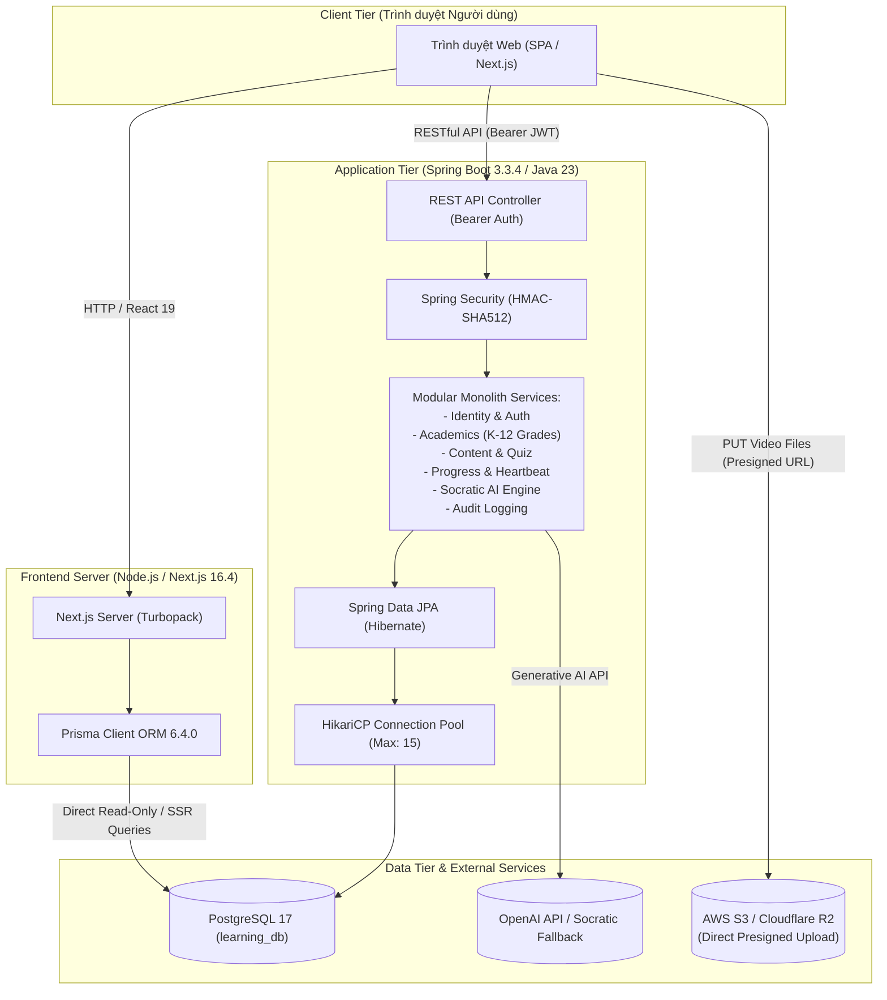
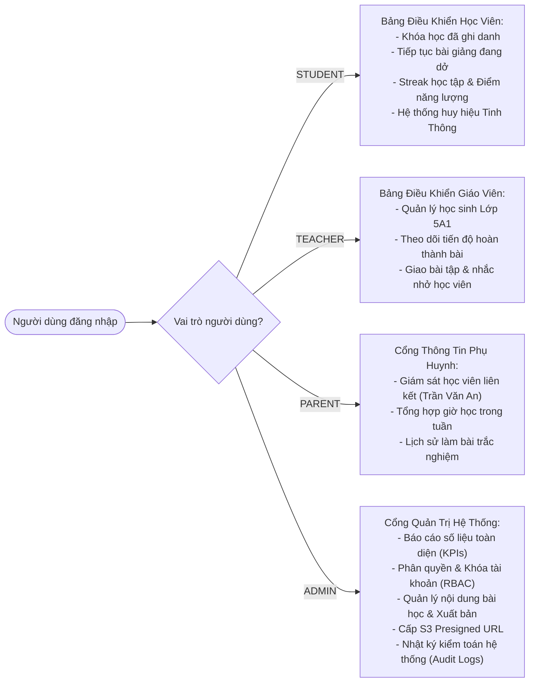
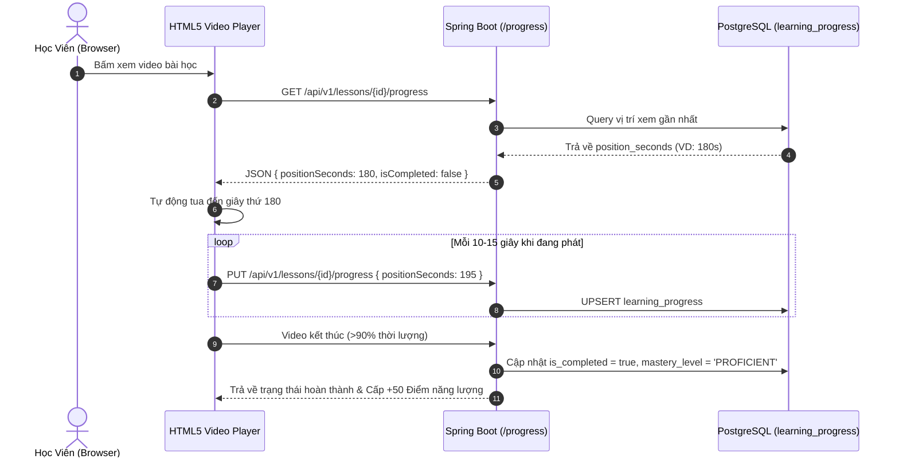
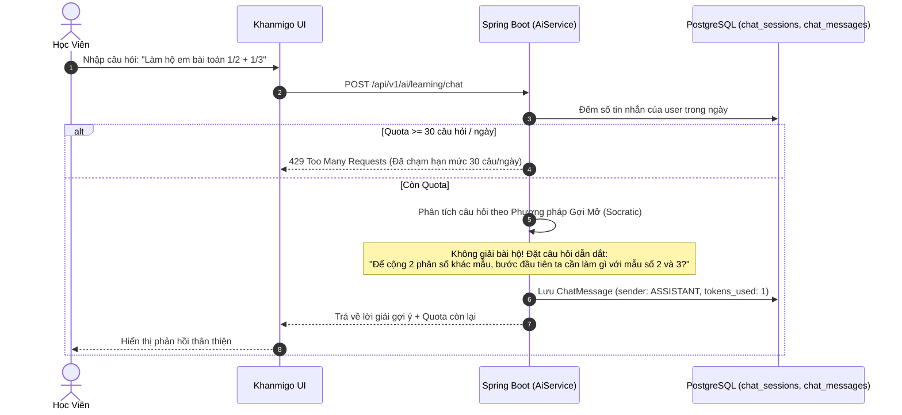
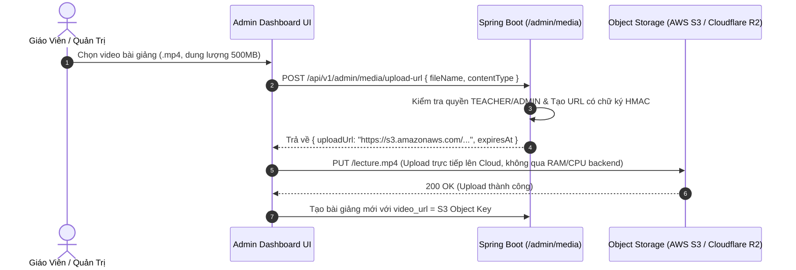
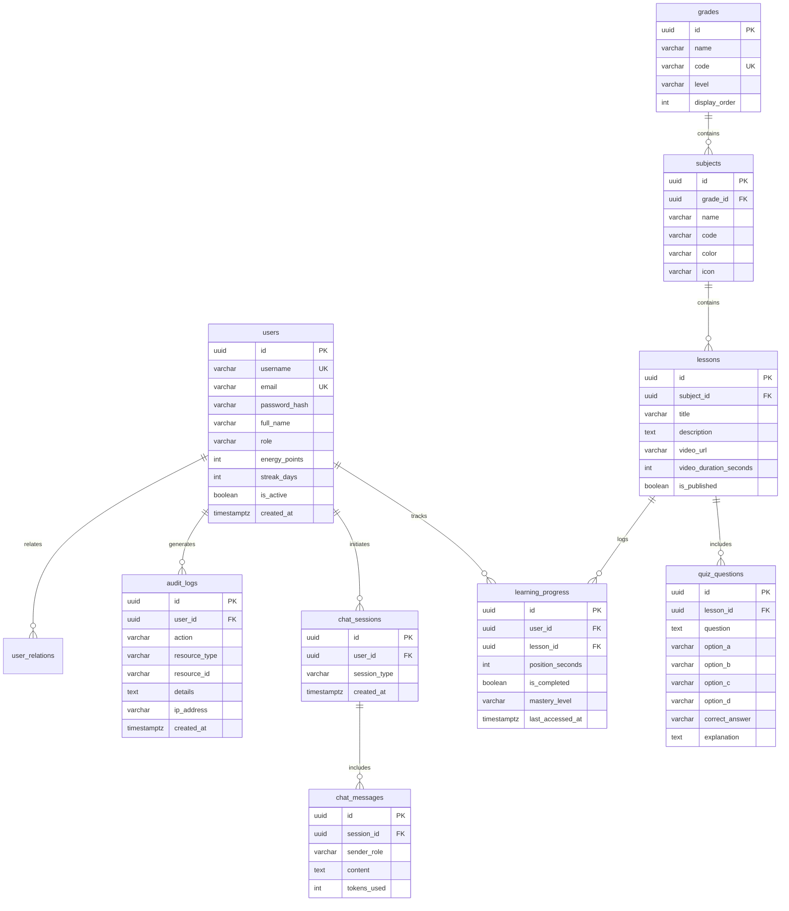

# TÀI LIỆU KIẾN TRÚC HỆ THỐNG WEBSITE GIÁO DỤC TRỰC TUYẾN K–12
## (Phiên bản cập nhật mới nhất — Chuẩn Khan Academy & Đặc tả Kỹ thuật 12 trang)

> **Dự án**: Nền Tảng Giáo Dục Trực Tuyến K–12 (Lớp 1 đến Lớp 12)  
> **Phong cách trải nghiệm**: [Khan Academy](https://www.khanacademy.org/)  
> **Mô hình kiến trúc**: Modular Monolith tách biệt Client-Server + Dual-ORM Support (Spring Data JPA & Prisma ORM)  
> **Ngày cập nhật**: Tháng 10/2026  

---

## MỤC LỤC
1. [Tổng Quan Hệ Thống & Nguyên Tắc Thiết Kế](#1-tổng-quan-hệ-thống--nguyên-tắc-thiết-kế)
2. [Sơ Đồ Kiến Trúc Tổng Thể](#2-sơ-đồ-kiến-trúc-tổng-thể)
3. [Phân Tầng Công Nghệ (Technology Stack)](#3-phân-tầng-công-nghệ-technology-stack)
4. [Kiến Trúc Bảng Điều Khiển Đa Vai Trò (Multi-Role Dashboard)](#4-kiến-trúc-bảng-điều-khiển-đa-vai-trò-multi-role-dashboard)
5. [Cơ Chế Tích Hợp Dual-ORM (Spring Data JPA & Prisma)](#5-cơ-chế-tích-hợp-dual-orm-spring-data-jpa--prisma)
6. [Mô Hình Bảo Mật & Phân Quyền (RBAC + Audit Logging)](#6-mô-hình-bảo-mật--phân-quyền-rbac--audit-logging)
7. [Luồng Nghiệp Vụ Trọng Yếu](#7-luồng-nghiệp-vụ-trọng-yếu)
   * [7.1. Video Streaming & Đồng Bộ Tiến Độ (Heartbeat Sync)](#71-video-streaming--đồng-bộ-tiến-độ-heartbeat-sync)
   * [7.2. Gia Sư Trí Tuệ Nhân Tạo Socratic & Giới Hạn Quota](#72-gia-sư-trí-tuệ-nhân-tạo-socratic--giới-hạn-quota)
   * [7.3. Tải Lên Media Trực Tiếp Qua S3 Presigned URL](#73-tải-lên-media-trực-tiếp-qua-s3-presigned-url)
8. [Cơ Sở Dữ Liệu & Sơ Đồ Thực Thể Quan Hệ (PostgreSQL ERD)](#8-cơ-sở-dữ-liệu--sơ-đồ-thực-thể-quan-hệ-postgresql-erd)
9. [Danh Mục RESTful API Endpoints](#9-danh-mục-restful-api-endpoints)
10. [Hướng Dẫn Cài Đặt & Vận Hành](#10-hướng-dẫn-cài-đặt--vận-hành)

---

## 1. Tổng Quan Hệ Thống & Nguyên Tắc Thiết Kế

Hệ thống được thiết kế theo đúng tiêu chuẩn trong tài liệu đặc tả 12 trang:
* **Tính sẵn sàng & Khả năng mở rộng**: Backend xây dựng dưới dạng **Modular Monolith** phân chia rõ ràng theo Domain-Driven Design (Identity, Academics, Content, Progress, Assessment, AI, Audit). Sẵn sàng tách thành microservices khi lượng truy cập vượt ngưỡng 10,000 CCU.
* **Bảo mật tuyệt đối**: Toàn bộ luồng dữ liệu bảo vệ qua Spring Security kết hợp JSON Web Token (JJWT) sử dụng thuật toán **HMAC-SHA512** và mã băm mật khẩu **BCrypt (Cost Factor 10)**.
* **Giao diện đẳng cấp Khan Academy**: Gamification toàn diện (Điểm năng lượng, chuỗi học tập Streak, huy hiệu), bố cục tối giản tập trung, tone màu nhận diện thương hiệu (`#14BF96`, `#1865F2`, `#0A2540`).

---

## 2. Sơ Đồ Kiến Trúc Tổng Thể

### Sơ Đồ C4 Container Diagram


---

## 3. Phân Tầng Công Nghệ (Technology Stack)

| Tầng hệ thống | Công nghệ sử dụng | Vai trò & Mục đích |
| :--- | :--- | :--- |
| **Frontend Framework** | **Next.js 16.4 (Turbopack)** | Server-side rendering (SSR), Client routing, Static generation |
| **Giao diện (UI)** | **React 19 + Tailwind CSS v4** | Hệ thống component phong cách Khan Academy, micro-interactions |
| **Frontend ORM** | **Prisma 6.4.0** | Hỗ trợ Server Actions & Route Handlers truy vấn trực tiếp DB |
| **Backend Framework** | **Java 23 + Spring Boot 3.3.4** | Tầng nghiệp vụ trung tâm (Business Logic & Authorization) |
| **Kiến trúc Backend**| **Modular Monolith** | Chia module rành mạch theo ngữ cảnh (Bounded Contexts) |
| **ORM Backend** | **Spring Data JPA / Hibernate** | Quản lý vòng đời Entity, Caching, Batch Fetching chống N+1 |
| **Database** | **PostgreSQL 17** | Cơ sở dữ liệu quan hệ ACID, hỗ trợ UUID gen_random_uuid() |
| **Migration** | **Flyway 10.x** | Quản lý phiên bản schema tự động (`V1`, `V2`, `V3`) |
| **Xác thực (Auth)** | **Spring Security + JJWT 0.12.6**| Stateless JWT token mã hóa thuật toán **HMAC-SHA512** |
| **Mật khẩu** | **BCrypt** | Mã băm mật khẩu 1 chiều, độ an toàn cao (Cost factor 10) |
| **Video & Streaming** | **HTML5 + WebVTT** | Phát video, phụ đề CC song ngữ, kiểm soát playback speed (0.5x - 2x) |
| **Tài liệu API** | **SpringDoc OpenAPI 3.0** | Swagger UI tương tác trực tiếp (`/swagger-ui.html`) |

---

## 4. Kiến Trúc Bảng Điều Khiển Đa Vai Trò (Multi-Role Dashboard)

Hệ thống cung cấp 2 phương thức truy cập Bảng điều khiển:
1. **Truy cập nhanh trong ứng dụng (`SPA ActiveView`)**: Nút **"Bảng Điều Khiển"** ngay trên thanh Header cho phép chuyển đổi tức thì không cần tải lại trang.
2. **Đường dẫn riêng biệt (`/dashboard`)**: Route Next.js độc lập [http://localhost:3000/dashboard](http://localhost:3000/dashboard) hỗ trợ đầy đủ 4 chế độ hiển thị theo vai trò người dùng (RBAC):



---

## 5. Cơ Chế Tích Hợp Dual-ORM (Spring Data JPA & Prisma)

Dự án áp dụng mô hình **Dual-ORM chuyên nghiệp**:

1. **Spring Data JPA (Master Write & Core Business Engine)**:
   * Chịu trách nhiệm toàn quyền đối với các luồng ghi dữ liệu phức tạp: chấm điểm tự động, tính streak, trừ quota AI, mã hóa mật khẩu, ghi nhật ký kiểm toán (Audit Log).
   * Schema database được đồng bộ và kiểm soát thông qua **Flyway Migration**.

2. **Prisma ORM (High-Performance Client & Next.js Server Side)**:
   * Tọa lạc tại `education-frontend/prisma/schema.prisma`.
   * Sử dụng lệnh `npx prisma db pull` để tự động đọc toàn bộ cấu trúc bảng từ PostgreSQL `learning_db`.
   * Cung cấp **Singleton Client** [prisma.ts](file:///c:/DMKlab-Project/education-frontend/src/lib/prisma.ts) với Typescript Type-Safety tuyệt đối cho Next.js Server Actions và Route Handlers (ví dụ: `/api/prisma-test`).

---

## 6. Mô Hình Bảo Mật & Phân Quyền (RBAC + Audit Logging)

### Ma Trận Phân Quyền (RBAC Matrix)

| Chức năng / API Endpoint | STUDENT | TEACHER | PARENT | ADMIN |
| :--- | :---: | :---: | :---: | :---: |
| Xem danh mục khối lớp, môn học, bài giảng | ✅ | ✅ | ✅ | ✅ |
| Xem video bài học & Tải phụ đề WebVTT | ✅ | ✅ | ✅ | ✅ |
| Gửi Heartbeat lưu vị trí video | ✅ | ✅ | ❌ | ✅ |
| Làm bài trắc nghiệm & Nhận điểm năng lượng | ✅ | ❌ | ❌ | ✅ |
| Chat với Gia sư Socratic Khanmigo (Quota 30/ngày)| ✅ | ✅ | ❌ | ✅ |
| Quản lý lớp học & Phân công bài tập | ❌ | ✅ | ❌ | ✅ |
| Giám sát tiến độ học tập của con cái | ❌ | ❌ | ✅ | ✅ |
| Tạo / Cập nhật / Xuất bản bài giảng | ❌ | ✅ | ❌ | ✅ |
| Bật / Tắt trạng thái tài khoản người dùng | ❌ | ❌ | ❌ | ✅ |
| Xem nhật ký kiểm toán hệ thống (Audit Logs) | ❌ | ❌ | ❌ | ✅ |
| Cấp Presigned S3 Upload URL | ❌ | ✅ | ❌ | ✅ |

### Cơ Chế Ghi Nhật Ký Kiểm Toán (Audit Logging)
Mọi tác vụ nhạy cảm (Đổi trạng thái tài khoản, Cấp URL tải lên, Đổi mật khẩu) đều được `AuditService` ghi nhận vào bảng `audit_logs` bao gồm:
* `user_id`: ID người thực hiện
* `action`: Tên hành động (`USER_STATUS_CHANGE`, `GENERATE_UPLOAD_URL`,...)
* `resource_type` & `resource_id`: Đối tượng tác động
* `details`: Chi tiết thay đổi trước và sau
* `ip_address` & `created_at`: Địa chỉ IP và thời điểm thực hiện

---

## 7. Luồng Nghiệp Vụ Trọng Yếu

### 7.1. Video Streaming & Đồng Bộ Tiến Độ (Heartbeat Sync)


### 7.2. Gia Sư Trí Tuệ Nhân Tạo Socratic & Giới Hạn Quota


### 7.3. Tải Lên Media Trực Tiếp Qua S3 Presigned URL


---

## 8. Cơ Sở Dữ Liệu & Sơ Đồ Thực Thể Quan Hệ (PostgreSQL ERD)



---

## 9. Danh Mục RESTful API Endpoints

Toàn bộ các endpoints đều được tài liệu hóa trực tiếp qua Swagger UI: [http://localhost:8080/swagger-ui.html](http://localhost:8080/swagger-ui.html)

### Nhóm Xác Thực & Hồ Sơ (`/api/v1/auth`)
* `POST /api/v1/auth/login`: Đăng nhập, nhận JWT Token (HMAC-SHA512).
* `POST /api/v1/auth/register`: Đăng ký tài khoản (Học sinh, Giáo viên, Phụ huynh).
* `GET /api/v1/auth/me`: Kiểm tra thông tin phiên đăng nhập qua Bearer Token.
* `PUT /api/v1/auth/profile`: Cập nhật thông tin cá nhân, bio, avatar.
* `POST /api/v1/auth/change-password`: Đổi mật khẩu tài khoản.

### Nhóm Học Liệu & Khối Lớp (`/api/v1/grades`, `/subjects`, `/lessons`)
* `GET /api/v1/grades`: Lấy danh sách 12 khối lớp K-12.
* `GET /api/v1/grades/{gradeId}/subjects`: Lấy môn học theo khối lớp.
* `GET /api/v1/subjects/{subjectId}/lessons`: Lấy bài học theo môn học.
* `GET /api/v1/lessons/{lessonId}`: Chi tiết bài học, video URL, phụ đề.
* `GET /api/v1/lessons/{lessonId}/quiz`: Lấy câu hỏi trắc nghiệm kiểm tra độ tinh thông.

### Nhóm Tiến Độ Học Tập & Chấm Điểm (`/api/v1/lessons`, `/quiz`)
* `PUT /api/v1/lessons/{lessonId}/progress`: Nhận heartbeat cập nhật vị trí video.
* `GET /api/v1/lessons/{lessonId}/progress`: Lấy vị trí xem video gần nhất.
* `GET /api/v1/progress/summary`: Thống kê bài học đã xong, streak, điểm năng lượng.
* `POST /api/v1/lessons/{lessonId}/quiz/submit`: Chấm điểm tự động và cấp điểm năng lượng.

### Nhóm Trí Tuệ Nhân Tạo Socratic (`/api/v1/ai`)
* `POST /api/v1/ai/learning/chat`: Trao đổi với gia sư Socratic Khanmigo (Kiểm tra quota 30 câu/ngày).
* `POST /api/v1/ai/admin/chat`: Trợ lý thông minh hỗ trợ giáo viên và quản trị viên.
* `GET /api/v1/ai/sessions/{sessionId}/history`: Xem lại lịch sử các câu hỏi trong phiên.

### Nhóm Quản Trị Hệ Thống (`/api/v1/admin`)
* `GET /api/v1/admin/reports/overview`: Báo cáo số liệu KPIs, trạng thái JVM và HikariCP Pool.
* `GET /api/v1/admin/users`: Danh sách người dùng theo phân quyền RBAC.
* `PATCH /api/v1/admin/users/{userId}/status`: Bật / Tắt trạng thái hoạt động tài khoản.
* `GET /api/v1/admin/audit-logs`: Truy xuất nhật ký kiểm toán hệ thống.
* `POST /api/v1/admin/media/upload-url`: Cấp S3 Presigned URL để upload file video.

---

## 10. Hướng Dẫn Cài Đặt & Vận Hành

### Yêu cầu môi trường
* **Java**: OpenJDK 21 hoặc Java 23
* **Node.js**: Node.js 20 LTS trở lên & npm 10+
* **PostgreSQL**: PostgreSQL 16 hoặc 17 chạy tại cổng `5432`

### Bước 1: Khởi tạo Cơ sở dữ liệu
```sql
CREATE DATABASE learning_db;
```
*(Flyway sẽ tự động chạy các script migration `V1`, `V2`, `V3` ngay khi backend khởi động)*.

### Bước 2: Chạy Backend Spring Boot
```bash
cd education-backend
mvn spring-boot:run
```
* Backend lắng nghe tại: `http://localhost:8080`
* Swagger UI tương tác: `http://localhost:8080/swagger-ui.html`

### Bước 3: Chạy Frontend Next.js
```bash
cd education-frontend
npm install
npx prisma generate
npm run dev
```
* Trang chủ ứng dụng: `http://localhost:3000`
* Bảng điều khiển đa vai trò: `http://localhost:3000/dashboard`
* Endpoint kiểm tra Prisma: `http://localhost:3000/api/prisma-test`

### Danh sách tài khoản thử nghiệm có sẵn
Mật khẩu chung cho tất cả tài khoản mẫu là: `password123`

| Tên đăng nhập | Vai trò | Tên hiển thị | Ghi chú |
| :--- | :--- | :--- | :--- |
| **`admin`** | `ADMIN` | Quản Trị Viên Hệ Thống | Toàn quyền quản trị, kiểm toán, cấp URL S3 |
| **`teacher_mai`** | `TEACHER` | Cô Nguyễn Thị Mai | Quản lý lớp 5A1, tạo bài giảng, phân công |
| **`student_an`** | `STUDENT` | Trần Văn An | 2,500 điểm năng lượng, chuỗi học 7 ngày |
| **`hocsinh1`** | `STUDENT` | Nguyen Van A | 1,500 điểm năng lượng |
