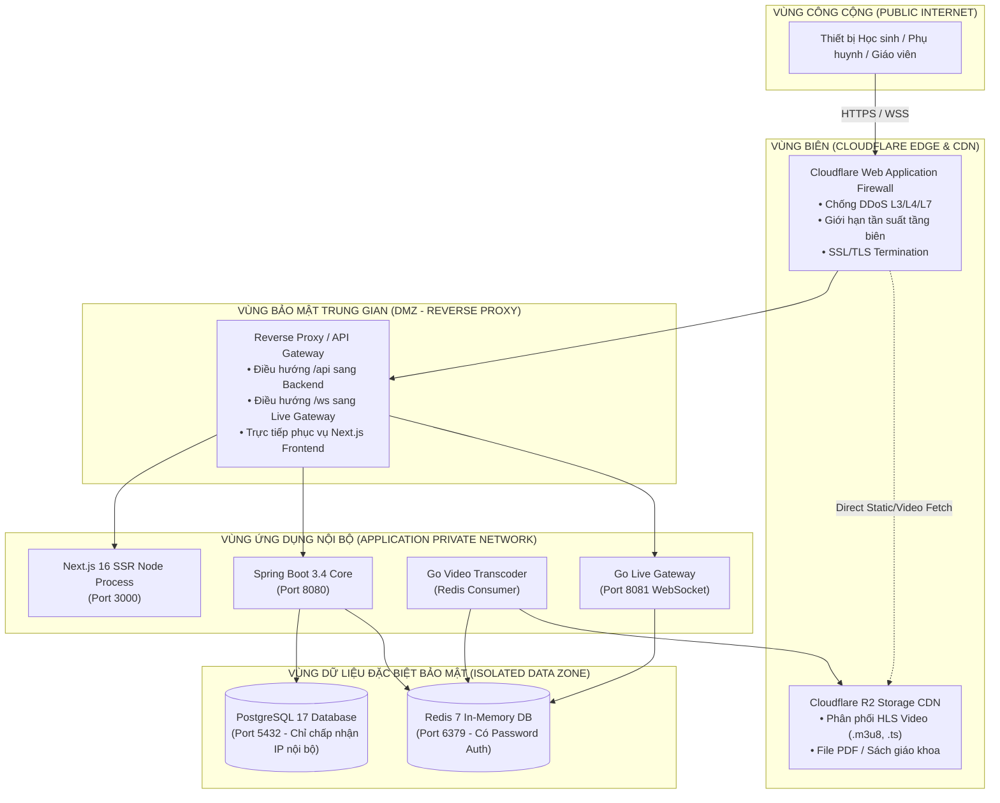
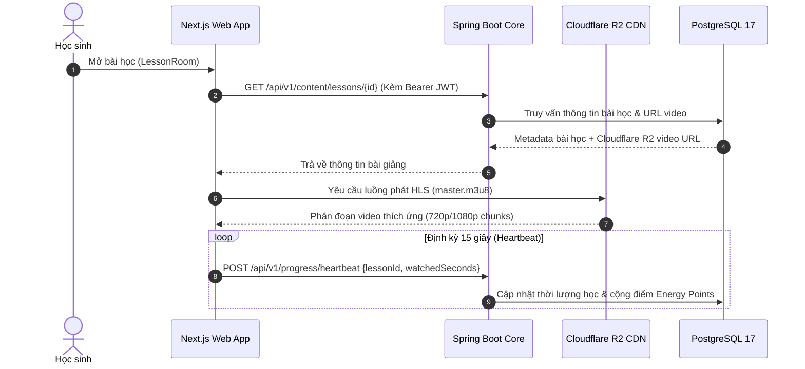
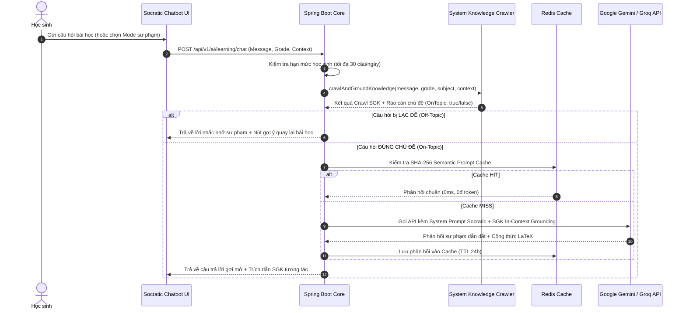
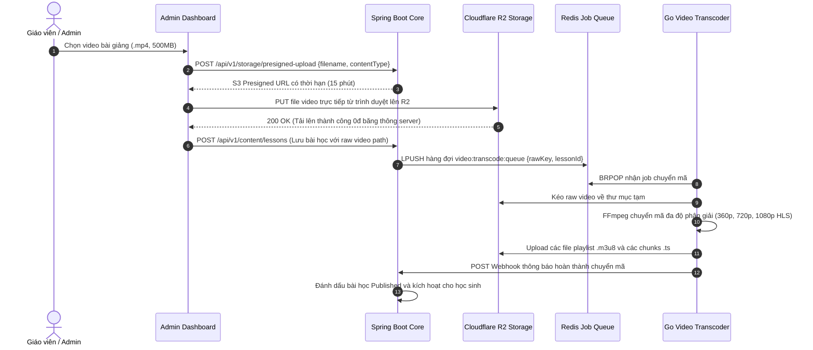

# 🏛️ 01. TỔNG QUAN KIẾN TRÚC HỆ THỐNG WEB (ARCHITECTURE OVERVIEW)

> **Mục tiêu**: Định hình kiến trúc tổng thể, mô hình phân tầng, nguyên lý giao tiếp giữa các thành phần và phân tích công nghệ lựa chọn cho hệ sinh thái **DMKLab Education Platform**.

---

## 1. NGUYÊN LÝ THIẾT KẾ CỐT LÕI (CORE DESIGN PRINCIPLES)

1. **Kiến trúc Modular Monolith kết hợp Event-Driven Workers**:
   - Nhân xử lý nghiệp vụ chính (`education-backend`) được tổ chức theo mô hình **Modular Monolith** trên nền tảng **Spring Boot 3.4 (Java 21)**. Kiến trúc này mang lại sự đơn giản trong triển khai, giảm thiểu chi phí quản lý hạ tầng so với microservices phân tán quá sớm, nhưng vẫn đảm bảo tính độc lập cao giữa các module nghiệp vụ (`identity`, `academics`, `content`, `assessment`, `progress`, `ai`, `platform`).
   - Các tác vụ tiêu tốn CPU/I/O lớn và yêu cầu đồng thời cao (Transcoding video FFmpeg, WebSocket Live Hub, AI Streaming Proxy) được tách biệt thành các **Worker viết bằng ngôn ngữ Go**, giao tiếp phi đồng bộ qua Redis Queue và Pub/Sub.

2. **Nguyên lý Lưu trữ Tối ưu Chi phí (Zero Egress Cost Architecture)**:
   - Toàn bộ video bài giảng phân đoạn HLS, ảnh chụp, tài liệu học tập được lưu trữ trực tiếp trên **Cloudflare R2**.
   - Trình duyệt học sinh/giáo viên tải file lên R2 thông qua cơ chế **S3 Presigned URL** do Spring Boot cấp phát. Dữ liệu nhị phân không đi qua máy chủ ứng dụng, giúp giảm tải 100% băng thông tải lên cho Backend và không mất phí truyền tải dữ liệu (0đ Egress).

3. **Solid Enterprise UI & Tiêu chuẩn Accessibility WCAG 2.1**:
   - Giao diện được thiết kế theo trường phái **Solid Surface (Màu đặc phẳng doanh nghiệp)**, loại bỏ triệt để hiệu ứng làm mờ kính (`backdrop-blur`) nhằm đảm bảo tốc độ dựng hình đạt mượt mà **60fps** trên cả các thiết bị học sinh cấu hình thấp.
   - Độ tương phản màu sắc đạt chuẩn WCAG 2.1 AA/AAA, tối ưu trải nghiệm đọc tài liệu sách giáo khoa nhiều giờ liên tục.

4. **Trợ lý Socratic AI 2.0 & An toàn Sư phạm K-12**:
   - Áp dụng phương pháp sư phạm Socratic (gợi mở tư duy từng bước, không giải hộ đáp án).
   - Tích hợp **Động cơ Crawl tài liệu hệ thống & Rào cản bảo vệ chủ đề (Strict Topic Guardrail)** nhằm triệt tiêu hiện tượng AI nói lan man, trả lời sai lệch (Hallucination) hoặc trả lời các chủ đề ngoài học thuật.

---

## 2. BẢN ĐỒ CÔNG NGHỆ (TECHNOLOGY STACK)

| Phân tầng | Công nghệ lựa chọn | Phiên bản | Vai trò & Lý do lựa chọn |
| :--- | :--- | :---: | :--- |
| **Frontend Framework** | Next.js (App Router) | 16.4.5 | Server-Side Rendering (SSR), Static Site Generation (SSG), Turbopack tối ưu build siêu tốc |
| **UI Library & State** | React 19 + TypeScript | 19.x / 5.x | Quản lý kiểu tĩnh nghiêm ngặt, React Hooks, Context API |
| **Styling & Icons** | Tailwind CSS + React Icons | 4.x / 5.x | Thiết kế Solid UI hiện đại, tiện ích utility-first, không phát sinh CSS dư thừa |
| **Math & Media** | KaTeX + Plyr.js + HLS.js | Mới nhất | Hiển thị công thức toán học LaTeX chuẩn xác, phát video trực tuyến phân đoạn thích ứng |
| **Backend Core** | Spring Boot | 3.4.0 | Nền tảng doanh nghiệp ổn định, kiến trúc Spring Security 6, Spring Data JPA, Actuator |
| **Ngôn ngữ Backend** | Java (OpenJDK) | 21 LTS | Virtual Threads (Project Loom), Pattern Matching, Garbage Collector ZGC/G1 độ trễ thấp |
| **Background Workers** | Go (Golang) | 1.22+ | Đa nhiệm goroutine siêu nhẹ, biên dịch nhị phân trực tiếp cho Video Transcoder & Live Hub |
| **Cơ sở dữ liệu chính** | PostgreSQL | 17.x | RDBMS mạnh mẽ, hỗ trợ JSONB, chỉ mục B-Tree Composite, Prepared Statements tối ưu |
| **Database Migration** | Flyway | 10.x | Kiểm soát phiên bản schema tự động từ V1 đến V7, an toàn tuyệt đối khi triển khai CI/CD |
| **Cache & Message Queue** | Redis | 7.x | Sliding-window Rate Limiting, Semantic Prompt Cache, Token Blacklist, Job Queue |
| **Object Storage** | Cloudflare R2 (S3 API) | Cloud | Lưu trữ video HLS, tài liệu SGK, avatar người dùng với chính sách 0đ phí truyền tải |
| **Giám sát & Đo lường** | Prometheus + Alertmanager | Mới nhất | Thu thập metric hệ thống (CPU, RAM, HikariCP, JVM, HTTP Latency) và kích hoạt cảnh báo |
| **Trực quan hóa** | Grafana | Mới nhất | Dashboard giám sát thời gian thực cho kỹ sư vận hành và quản trị hệ thống |
| **AI Cloud Gateway** | Gemini 2.5, Groq, OpenAI | Cloud | Động cơ suy luận Socratic đa tầng kết hợp Semantic Cache tiết kiệm 95% chi phí |

---

## 3. CÁC PHÂN VÙNG MẠNG VÀ BẢO VỆ (NETWORK & SECURITY ZONES)

---

## 4. CÁC LUỒNG DỮ LIỆU ĐIỂN HÌNH (END-TO-END DATA FLOWS)

### 4.1 Luồng Học tập Video & Đồng bộ tiến độ

### 4.2 Luồng Hỏi đáp Gia sư Socratic AI (Kèm Crawl SGK & Topic Guardrail)

### 4.3 Luồng Tải lên Video & Chuyển mã Tự động (Video Transcoding Pipeline)

