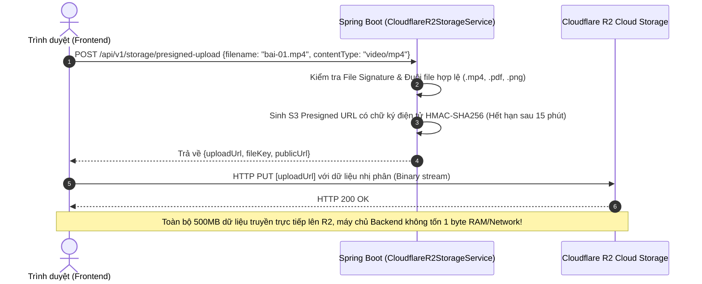

# ⚙️ 02. CHI TIẾT KIẾN TRÚC BACKEND (SPRING BOOT 3.4 & JAVA 21)

> **Mã nguồn**: Thư mục `education-backend`  
> **Ngôn ngữ**: Java 21 (OpenJDK LTS)  
> **Framework**: Spring Boot 3.4.0 (Spring Framework 6.2, Spring Security 6)  
> **Mô hình kiến trúc**: Modular Monolith  

---

## 1. CẤU TRÚC PHÂN CHIA MODULE (MODULAR MONOLITH STRUCTURE)

Mã nguồn Backend được tổ chức thành các gói nghiệp vụ độc lập cao (High Cohesion, Loose Coupling), phản ánh đúng ranh giới ngữ cảnh (Bounded Contexts) theo tư duy Domain-Driven Design (DDD):

```
education-backend/src/main/java/com/example/learning/
├── EducationBackendApplication.java       # Lớp khởi chạy Spring Boot chính
│
├── identity/                              # [MODULE 1: ĐỊNH DANH & XÁC THỰC]
│   ├── controller/AuthController.java     # Đăng ký, Đăng nhập, Đổi mật khẩu, Logout
│   ├── dto/AuthDto.java                   # LoginRequest, RegisterRequest, AuthResponse
│   ├── entity/User.java                   # Thực thể người dùng hệ thống
│   ├── entity/UserRole.java               # Enum vai trò: STUDENT, TEACHER, ADMIN, PARENT
│   ├── repository/UserRepository.java     # JPA Repository truy vấn người dùng
│   └── service/UserService.java           # Nghiệp vụ quản lý tài khoản & hồ sơ
│
├── academics/                             # [MODULE 2: KHUNG CHƯƠNG TRÌNH K-12]
│   ├── controller/AcademicsController.java# API tra cứu danh mục Khối lớp & Môn học
│   ├── entity/Grade.java                  # Thực thể Khối lớp (Lớp 1 đến Lớp 12)
│   ├── entity/GradeLevel.java             # Enum cấp học: PRIMARY, SECONDARY, HIGH_SCHOOL
│   ├── entity/Subject.java                # Thực thể Môn học (Toán, Vật lý, Hóa học, ...)
│   ├── repository/GradeRepository.java    # Truy vấn khối lớp
│   ├── repository/SubjectRepository.java  # Truy vấn môn học
│   └── service/AcademicsService.java      # Nghiệp vụ danh mục sư phạm
│
├── content/                               # [MODULE 3: NỘI DUNG BÀI HỌC & VIDEO]
│   ├── controller/ContentController.java  # API danh sách bài học, bài giảng theo môn
│   ├── entity/Lesson.java                 # Thực thể bài giảng (Video HLS, Thumbnail, Thứ tự)
│   ├── entity/QuizQuestion.java           # Câu hỏi trắc nghiệm kiểm tra bài học
│   ├── repository/LessonRepository.java   # Truy vấn bài giảng đã công bố
│   ├── repository/QuizRepository.java     # Truy vấn câu hỏi theo bài học
│   └── service/ContentService.java        # Nghiệp vụ quản lý xuất bản bài giảng
│
├── assessment/                            # [MODULE 4: ĐÁNH GIÁ & CHẤM ĐIỂM]
│   ├── controller/AssessmentController.java # Nộp bài làm trắc nghiệm & Tính điểm
│   ├── dto/QuizSubmissionDto.java         # Dữ liệu nộp bài & Kết quả phản hồi
│   └── service/AssessmentService.java     # Nghiệp vụ chấm điểm tự động & Gợi ý sửa sai
│
├── progress/                              # [MODULE 5: TIẾN ĐỘ HỌC TẬP & GAMIFICATION]
│   ├── controller/ProgressController.java # Heartbeat xem video & Thống kê cá nhân
│   ├── dto/ProgressDto.java               # Dữ liệu tiến độ, Điểm năng lượng, Streak
│   ├── entity/LearningProgress.java       # Lưu tiến độ từng bài học của học sinh
│   ├── repository/LearningProgressRepository.java # Truy vấn tiến độ
│   └── service/ProgressService.java       # Quản lý chuỗi ngày học tập & Điểm thưởng
│
├── ai/                                    # [MODULE 6: GIA SƯ SOCRATIC AI & CRAWLER]
│   ├── controller/AiController.java       # API Chat Socratic, SSE Stream, RLHF Feedback
│   ├── dto/AiChatDto.java                 # ChatRequest, ChatResponse, Citations, Quiz
│   ├── entity/ChatSession.java            # Lưu phiên trò chuyện AI
│   ├── entity/ChatMessage.java            # Lưu từng tin nhắn (kèm Feedback RLHF)
│   ├── repository/ChatSessionRepository.java # Truy vấn phiên
│   ├── repository/ChatMessageRepository.java # Truy vấn tin nhắn & Quota
│   ├── service/AiService.java             # Bộ điều phối Socratic, Trí nhớ, Caching
│   └── service/SystemKnowledgeCrawlerService.java # Crawler SGK K-12 & Topic Guardrail
│
└── platform/                              # [MODULE 7: NỀN TẢNG KỸ THUẬT & HẠ TẦNG]
    ├── admin/                             # AdminReportService, AdminController (CMS)
    ├── api/ApiResponse.java               # Cấu trúc phản hồi JSON chuẩn hóa
    ├── audit/                             # AuditLog, AuditLogRepository, AuditService
    ├── config/                            # AppConfig, WebSecurityConfig, RedisConfig, CacheConfig
    ├── email/EmailService.java            # Gửi email kích hoạt & Quên mật khẩu
    ├── exception/GlobalExceptionHandler.java # Bắt và chuẩn hóa lỗi toàn cục
    ├── ratelimit/                         # RateLimitingFilter, RateLimiterService (RFC 6585)
    ├── security/                          # JwtTokenProvider, JwtAuthenticationFilter, Blacklist
    └── storage/                           # CloudflareR2StorageService, Presigned S3 Upload
```

---

## 2. BẢO MẬT & XÁC THỰC PHÂN QUYỀN (SECURITY & RBAC)

### 2.1 Chuỗi bộ lọc bảo mật (Spring Security 6 Filter Chain)
Cấu hình trong `WebSecurityConfig.java`:
1. **CorsConfigurationSource**: Giới hạn Origin nghiêm ngặt (chỉ chấp nhận domain frontend `http://localhost:3000` hoặc domain sản xuất chính thức).
2. **CSRF**: Vô hiệu hóa có chủ đích vì API sử dụng Bearer Token hoàn toàn Stateless, không dùng Session Cookie.
3. **SessionManagement**: Đặt ở chế độ `SessionCreationPolicy.STATELESS`.
4. **Security Headers**:
   - `Content-Security-Policy`: Ngăn chặn nạp script độc hại từ bên thứ ba.
   - `X-Frame-Options: DENY`: Chống tấn công Clickjacking.
   - `X-Content-Type-Options: nosniff`: Ngăn chặn MIME-type sniffing.
   - `Strict-Transport-Security (HSTS)`: Ép buộc kết nối HTTPS 100%.

### 2.2 Token JWT HMAC-SHA512 & Danh sách đen Redis (Token Blacklisting)
- Khi người dùng đăng nhập thành công, hệ thống cấp phát một JWT được ký bằng thuật toán **HMAC-SHA512** với Secret Key an toàn tối thiểu 512-bit.
- **Payload Token**: Chứa `userId`, `username`, `fullName`, `role` (`STUDENT`, `TEACHER`, `ADMIN`, `PARENT`).
- **Thu hồi Token tức thì khi Đăng xuất (Token Blacklist)**:
  - Khi học sinh hoặc giáo viên bấm "Đăng xuất" (`POST /api/v1/auth/logout`), token hiện tại được đẩy vào Redis thông qua `JwtBlacklistService` với TTL bằng đúng thời gian sống còn lại của token.
  - Trong mỗi request, `JwtAuthenticationFilter` kiểm tra Redis: nếu token nằm trong Blacklist, request bị chặn ngay lập tức với mã lỗi `401 Unauthorized`.

---

## 3. BỘ LỌC GIỚI HẠN TẦN SUẤT TRUY CẬP (SLIDING-WINDOW RATE LIMITING)

Được triển khai trong `RateLimitingFilter.java` và `RateLimiterService.java`:
- **Nguyên lý hoạt động**: Thuật toán Sliding-Window dựa trên Redis In-Memory. Mỗi IP hoặc Client Identifier được gán một danh sách timestamp các request gần nhất.
- **Hỗ trợ Reverse Proxy Cloudflare**:
  - Tự động trích xuất IP thực của học sinh từ header `CF-Connecting-IP` hoặc `X-Forwarded-For`, loại bỏ hoàn toàn rủi ro chặn nhầm IP của Gateway Proxy.
- **Tuân thủ chuẩn IETF RFC 6585**:
  - Khi người dùng gửi request vượt ngưỡng cho phép, hệ thống trả về mã trạng thái HTTP:
    `429 Too Many Requests`
  - Đi kèm các HTTP response headers tiêu chuẩn:
    - `Retry-After: <số giây cần chờ>`
    - `X-RateLimit-Limit: <hạn mức tối đa>`
    - `X-RateLimit-Remaining: 0`
    - `X-RateLimit-Reset: <thời điểm đặt lại>`

---

## 4. TÍCH HỢP CLOUDFLARE R2 VỚI S3 PRESIGNED URL (0Đ BĂNG THÔNG)

Được quản lý trong `CloudflareR2StorageService.java` sử dụng **AWS Java SDK v2 (S3 Client)**:



**Lợi ích vượt trội**:
- **0đ Phí truyền tải dữ liệu (Zero Egress Fees)** của Cloudflare R2 giúp nền tảng tiết kiệm hàng ngàn USD chi phí băng thông video mỗi tháng so với AWS S3 thông thường.
- Không chiếm dụng tài nguyên CPU, RAM hoặc Disk I/O của máy chủ ứng dụng Spring Boot khi học sinh hay giáo viên tải file lớn.

---

## 5. TỐI ƯU HÓA KẾT NỐI DATABASE HIKARICP & CẤU HÌNH CACHE

### 5.1 Cấu hình Connection Pool HikariCP
Tối ưu hóa trong `application.yml` cho tải cao:
```yaml
spring:
  datasource:
    hikari:
      maximum-pool-size: 20
      minimum-idle: 10
      idle-timeout: 300000
      max-lifetime: 1200000
      connection-timeout: 20000
      leak-detection-threshold: 30000
```
- **Leak Detection**: Cảnh báo rò rỉ kết nối sau 30 giây nếu một transaction giữ kết nối quá lâu.
- **Maximum Pool Size**: Được tính toán tối ưu theo công thức chuẩn của PostgreSQL: `Pool Size = (Core_Count * 2) + Disk_Effective_Spindle`.

### 5.2 Bộ đệm phân tán Spring Data Redis (Spring Cache Manager)
- Các danh mục ít biến động như Khối lớp (`Grade`), Môn học (`Subject`), và Danh sách bài học được gắn annotation `@Cacheable(value = "lessons", key = "#subjectId")`.
- Thời gian sống (TTL) mặc định 30 phút, tự động xóa cache (Cache Eviction) khi quản trị viên cập nhật nội dung bài học.

---

## 6. QUẢN TRỊ METRIC & ĐO LƯỜNG VỚI PROMETHEUS / MICROMETER

- Tích hợp `micrometer-registry-prometheus` trong `pom.xml`.
- Expose endpoint thu thập metric tại:
  `GET /actuator/prometheus`
- **Các metric cốt lõi được giám sát tự động**:
  - `jvm_memory_used_bytes` / `jvm_gc_pause_seconds_count`: Theo dõi áp lực bộ nhớ và tần suất Garbage Collection.
  - `hikaricp_connections_active` / `hikaricp_connections_pending`: Cảnh báo nghẽn Connection Pool cơ sở dữ liệu.
  - `http_server_requests_seconds`: Đo lường chính xác phân vị thời gian phản hồi API (P50, P90, P99).
