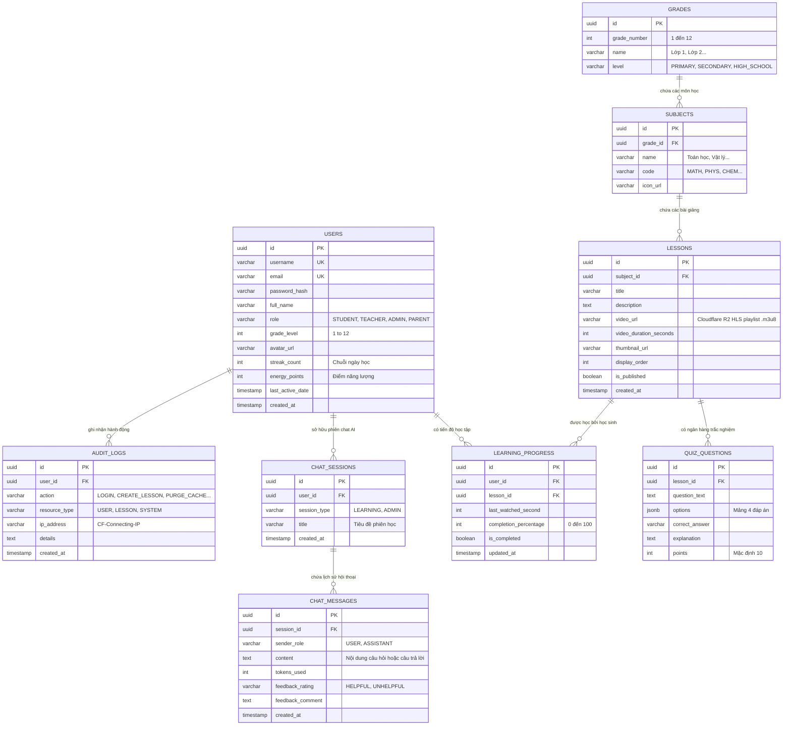

# 🗄️ 06. CƠ SỞ DỮ LIỆU & TẦNG LƯU TRỮ (DATABASE & STORAGE)

> **Cơ sở dữ liệu chính**: PostgreSQL 17  
> **Kiểm soát phiên bản Schema**: Flyway Migrations (V1 đến V7)  
> **Kho lưu trữ Object Storage**: Cloudflare R2 (Tương thích chuẩn S3 API)  
> **Bộ đệm In-Memory**: Redis 7.x  

---

## 1. SƠ ĐỒ THỰC THỂ LIÊN KẾT (ENTITY RELATIONSHIP DIAGRAM - ERD)



---

## 2. LỊCH SỬ KIỂM SOÁT PHIÊN BẢN DATABASE (FLYWAY MIGRATIONS)

Hệ thống quản lý schema hoàn toàn tự động bằng Flyway trong thư mục `src/main/resources/db/migration/`:

| Tệp Migration | Phiên bản | Mô tả chi tiết thay đổi cấu trúc |
| :--- | :---: | :--- |
| `V1__initial_schema.sql` | **V1** | Khởi tạo toàn bộ các bảng nòng cốt: `users`, `grades`, `subjects`, `lessons`, `quiz_questions`, `learning_progress`, `chat_sessions`, `chat_messages`, `audit_logs`. Thiết lập khóa chính UUID và các ràng buộc Foreign Key. |
| `V2__seed_data.sql` | **V2** | Nạp dữ liệu mẫu chuẩn hóa GDPT 2018: 12 Khối lớp, các môn học cơ bản (Toán, Văn, Anh, Lý, Hóa, Sinh) và các bài học nhập môn kèm video demo. |
| `V3__user_profile_fields.sql` | **V3** | Mở rộng bảng `users`: Thêm `avatar_url`, `bio`, `phone`, `streak_count`, `energy_points`, `last_active_date` phục vụ phân hệ Gamification. |
| `V4__performance_indexes.sql` | **V4** | Tối ưu hóa hiệu năng truy vấn: Tạo chỉ mục tổng hợp (Composite Indexes) trên `lessons(subject_id, is_published, display_order)` và `learning_progress(user_id, lesson_id)`. |
| `V5__query_optimization_indexes.sql` | **V5** | Bổ sung chỉ mục B-Tree trên `users(username)`, `users(email)`, `audit_logs(created_at DESC)` tăng tốc báo cáo quản trị. |
| `V6__database_tuning_indexes.sql` | **V6** | Tinh chỉnh chỉ mục truy vấn lịch sử hội thoại `chat_messages(session_id, created_at ASC)` phục vụ bộ nhớ ngữ cảnh Multi-turn của AI. |
| `V7__ai_message_feedback.sql` | **V7** | Bổ sung hai cột `feedback_rating VARCHAR(20)` và `feedback_comment TEXT` vào bảng `chat_messages` phục vụ thu thập dữ liệu đánh giá RLHF. |

---

## 3. CHIẾN LƯỢC LẬP CHỈ MỤC TỐI ƯU HÓA TRUY VẤN (INDEXING STRATEGY)

Để đảm bảo mục tiêu hiệu năng **P95 < 50ms** dưới tải hàng ngàn học sinh cùng truy cập:
1. **Chỉ mục tổng hợp Bài học (Composite Index)**:
   ```sql
   CREATE INDEX idx_lessons_subject_published_order 
   ON lessons(subject_id, is_published, display_order ASC);
   ```
   *Mục đích*: Giúp câu lệnh lấy danh sách bài giảng theo môn học đạt tốc độ truy xuất tức thì dạng Index Scan, không cần duyệt toàn bộ bảng (Table Scan).
2. **Chỉ mục Độc nhất Tiến độ học tập**:
   ```sql
   CREATE UNIQUE INDEX uq_learning_progress_user_lesson 
   ON learning_progress(user_id, lesson_id);
   ```
   *Mục đích*: Đảm bảo mỗi học sinh chỉ có duy nhất 1 bản ghi tiến độ cho mỗi bài học, tối ưu hóa câu lệnh `ON CONFLICT DO UPDATE` khi gửi Heartbeat.
3. **Chỉ mục Lịch sử hội thoại AI**:
   ```sql
   CREATE INDEX idx_chat_messages_session_created 
   ON chat_messages(session_id, created_at ASC);
   ```
   *Mục đích*: Tải nhanh 6 tin nhắn gần nhất của phiên học trong vòng dưới **2ms** để nạp vào bộ nhớ Multi-turn Memory.

---

## 4. TẦNG LƯU TRỮ OBJECT STORAGE CLOUDFLARE R2 (S3 API)

### 4.1 Quy chuẩn cấu trúc đường dẫn lưu trữ (Folder Structure)
```
Cloudflare R2 Bucket (dmklab-education-assets)/
├── textbooks/                              # Tài liệu sách giáo khoa & E-Books
│   ├── toan-10-canh-dieu.json              # Dữ liệu có cấu trúc SGK Toán 10
│   └── toan-5-ket-noi.json                 # Dữ liệu có cấu trúc SGK Toán 5
├── videos/
│   ├── raw/                                # File video gốc do giáo viên upload (.mp4)
│   │   └── {upload-uuid}.mp4
│   └── hls/                                # Thư mục chứa video đã chuyển mã HLS
│       └── {lesson-id}/
│           ├── master.m3u8                 # Playlist HLS đa độ phân giải
│           ├── 1080p.m3u8 (kèm *.ts chunks)
│           ├── 720p.m3u8 (kèm *.ts chunks)
│           └── 360p.m3u8 (kèm *.ts chunks)
├── thumbnails/                             # Ảnh đại diện bài giảng (.webp, .jpg)
└── avatars/                                # Ảnh hồ sơ của học sinh / giáo viên
```

### 4.2 Cơ chế S3 Presigned URL & Zero Egress
- Toàn bộ thao tác tải lên của người dùng được bảo vệ thông qua URL có chữ ký điện tử HMAC-SHA256 (`POST /api/v1/storage/presigned-upload`).
- URL này chỉ có giá trị sử dụng trong vòng **15 phút**.
- Khi xem video, trình duyệt tải các phân đoạn `.ts` thông qua CDN toàn cầu của Cloudflare. Nhờ chính sách **Zero Egress Fee** của Cloudflare R2, hệ thống hoàn toàn không phải chi trả bất kỳ chi phí băng thông nào cho dù học sinh xem hàng triệu lượt video mỗi tháng.

