# ⚡ 07. CÁC DỊCH VỤ VỆ TINH & BACKGROUND WORKERS (GO & REDIS)

> **Mục tiêu**: Phân tích chi tiết kiến trúc và phương thức vận hành của các dịch vụ vệ tinh độc lập viết bằng **Go (Golang)**, đảm nhiệm các tác vụ đòi hỏi khả năng xử lý đồng thời cực lớn và tiêu tốn CPU/I/O cao.

---

## 1. DỊCH VỤ CHUYỂN MÃ VIDEO HLS (`video-transcoder-worker`)

> **Thư mục**: `video-transcoder-worker/`  
> **Ngôn ngữ**: Go 1.22+  
> **Công cụ lõi**: FFmpeg, Redis Client, AWS SDK for Go (S3)  

### 1.1 Sứ mệnh & Vấn đề giải quyết
Video gốc do giáo viên quay hoặc tải lên thường có dung lượng rất lớn (500MB – 2GB) và định dạng MP4 đơn lẻ. Nếu phát trực tiếp:
- Học sinh có mạng yếu sẽ bị giật, lag (buffering liên tục).
- Học sinh trên điện thoại phải tải toàn bộ file lớn, gây tốn dữ liệu di động (4G/5G).

`video-transcoder-worker` giải quyết triệt để vấn đề này bằng cách tự động cắt nhỏ video thành các phân đoạn dài 4–6 giây (`.ts`) và tạo các luồng phát thích ứng (**Adaptive Bitrate Streaming - HLS**).

### 1.2 Kiến trúc luồng xử lý (Processing Pipeline)

```mermaid
sequenceDiagram
    autonumber
    participant BE as Spring Boot
    participant Redis as Redis Queue (video:transcode:queue)
    participant Worker as video-transcoder-worker (Go)
    participant FFmpeg as FFmpeg Binary
    participant R2 as Cloudflare R2 Storage

    BE->>Redis: LPUSH job {lessonId, rawVideoKey}
    Worker->>Redis: BRPOP (Chờ nhận job theo thời gian thực)
    Worker->>R2: Download file video gốc về thư mục tạm /tmp
    
    rect rgb(20, 35, 60)
        Note over Worker,FFmpeg: Chuyển mã đa độ phân giải đồng thời
        Worker->>FFmpeg: Chuyển mã 1080p (Bitrate 4500k, H.264 / AAC)
        Worker->>FFmpeg: Chuyển mã 720p (Bitrate 2500k)
        Worker->>FFmpeg: Chuyển mã 360p (Bitrate 800k cho mạng yếu)
        Worker->>FFmpeg: Tạo playlist tổng master.m3u8
    end

    Worker->>R2: Upload master.m3u8, các playlist phụ và hàng trăm file .ts
    Worker->>BE: POST Webhook thông báo hoàn tất chuyển mã
    BE->>BE: Cập nhật lesson.video_url = "https://r2.../hls/{lessonId}/master.m3u8"
    Worker->>Worker: Xóa sạch thư mục tạm giải phóng ổ đĩa
```



### 1.3 Cấu hình lệnh FFmpeg HLS chuẩn công nghiệp
Được đóng gói trong `internal/ffmpeg/transcoder.go`:
```bash
ffmpeg -i input.mp4 \
  -filter_complex "[0:v]split=3[v1][v2][v3]; \
  [v1]scale=w=1920:h=1080[v1out]; \
  [v2]scale=w=1280:h=720[v2out]; \
  [v3]scale=w=640:h=360[v3out]" \
  -map "[v1out]" -c:v:0 libx264 -b:v:0 4500k \
  -map "[v2out]" -c:v:1 libx264 -b:v:1 2500k \
  -map "[v3out]" -c:v:2 libx264 -b:v:2 800k \
  -map a:0 -c:a aac -b:a 128k \
  -f hls -hls_time 6 -hls_playlist_type vod \
  -hls_segment_filename "output_%v_%03d.ts" \
  master_%v.m3u8
```

---

## 2. CỔNG KẾT NỐI LỚP HỌC THỜI GIAN THỰC (`live-gateway`)

> **Thư mục**: `live-gateway/`  
> **Ngôn ngữ**: Go 1.22+  
> **Giao thức**: WebSocket (`ws://` / `wss://`)  
> **Thư viện lõi**: `gorilla/websocket`, Redis Pub/Sub  

### 2.1 Sứ mệnh & Vấn đề giải quyết
Phục vụ các tính năng tương tác trực tiếp trong phòng học ảo:
- Khung chat trao đổi trực tiếp giữa giáo viên và học sinh trong buổi học trực tuyến.
- Điểm danh học sinh đang có mặt (Presence Detection).
- Giơ tay phát biểu, biểu quyết nhanh (Live Poll).

### 2.2 Mô hình Room Hub & Broadcast Concurrency
- **RoomHub Pattern**: Mỗi phòng học là một Hub quản lý danh sách các Client WebSocket đang kết nối.
- **Go Routines siêu nhẹ**: Mỗi kết nối chỉ tiêu tốn khoảng **4KB RAM**, cho phép một máy chủ thông thường duy trì đồng thời hơn **50,000 kết nối WebSocket song song** mà không gặp hiện tượng tràn bộ nhớ.
- **Phân tán qua Redis Pub/Sub**:
  - Khi có nhiều instance `live-gateway` chạy song song sau Load Balancer, các tin nhắn được phát tán (broadcast) xuyên suốt giữa các máy chủ qua kênh `redis.Publish("room:" + roomId, message)`.

---

## 3. PROXY PHÂN PHỐI LUỒNG TOKEN AI ĐỘ TRỄ THẤP (`ai-streaming-proxy`)

> **Thư mục**: `ai-streaming-proxy/`  
> **Ngôn ngữ**: Go 1.22+  
> **Giao thức**: Server-Sent Events (SSE - `text/event-stream`)  

### 3.1 Sứ mệnh & Vấn đề giải quyết
- Đóng vai trò là reverse proxy chuyên trách cho các luồng truyền token AI độ trễ thấp từ các nhà cung cấp (Gemini, Groq, OpenAI).
- Giảm tải cho máy chủ Spring Boot: Spring Boot chỉ cần ủy quyền việc duy trì kết nối HTTP dài hạn (Long-lived SSE Connections) cho Go Proxy.
- Tích hợp bộ đệm In-Memory và bộ đếm giới hạn tốc độ gõ chữ mượt mà (Smoothing Typist Token Delivery) cho học sinh.

