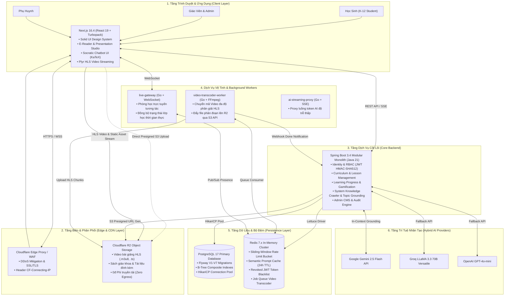

# 📚 HỆ THỐNG TÀI LIỆU KỸ THUẬT NỀN TẢNG GIÁO DỤC DMKLAB (K-12)

> **Dự án**: DMKLab Education Platform  
> **Phiên bản hệ thống**: 2.6 (Cập nhật Tháng 11/2026)  
> **Kiến trúc**: Solid Modular Monolith & High-Performance Go/SSE Workers  
> **Tiêu chuẩn thiết kế**: Enterprise Solid UI • WCAG 2.1 Accessibility • OWASP Top 10 Hardened • 60fps Performance  

---

## 📌 1. GIỚI THIỆU TỔNG QUAN

**DMKLab Education Platform** là hệ sinh thái giáo dục trực tuyến toàn diện chuẩn K–12 (Lớp 1 đến Lớp 12) dành cho học sinh, giáo viên, phụ huynh và nhà trường tại Việt Nam.

Hệ thống kết hợp tinh hoa từ các nền tảng giáo dục công nghệ hàng đầu thế giới:
- **Mô hình học tập tự chủ (Mastery Learning)** của [Khan Academy](https://www.khanacademy.org/).
- **Tư duy tương tác trực quan & trực giác toán học** của [Brilliant.org](https://brilliant.org/).
- **Gia sư sư phạm Socratic AI 2.0**: Phương pháp gợi mở tư duy, không làm hộ bài, chẩn đoán điểm ngộ nhận, bám sát 100% chương trình Giáo dục phổ thông (GDPT 2018) của Bộ Giáo dục & Đào tạo.

---

## 🗂️ 2. DANH MỤC TÀI LIỆU CHI TIẾT (DOCUMENTATION INDEX)

Bộ tài liệu này được cấu trúc thành các chuyên đề chuyên sâu, phân định rõ ràng giữa kiến trúc tổng thể, chi tiết các tầng kỹ thuật và ma trận toàn bộ chức năng:

| STT | Tài liệu | Mô tả nội dung chính |
| :---: | :--- | :--- |
| **01** | [**01-architecture-overview.md**](./01-architecture-overview.md) | **Tổng quan kiến trúc toàn hệ thống**: Sơ đồ phân tầng (High-Level Architecture), topo dịch vụ, luồng dữ liệu (Data Flows), phân tích công nghệ (Tech Stack). |
| **02** | [**02-backend-architecture.md**](./02-backend-architecture.md) | **Chi tiết kiến trúc Backend (`education-backend`)**: Spring Boot 3.4 & Java 21, Modular Monolith, Spring Security 6, JWT HMAC-SHA512, Redis Blacklist, Sliding-Window Rate Limiting, HikariCP. |
| **03** | [**03-frontend-architecture.md**](./03-frontend-architecture.md) | **Chi tiết kiến trúc Frontend (`education-frontend`)**: Next.js 16 App Router, React 19, Turbopack, Triết lý Solid Enterprise UI (100% Solid Color, Zero Glass Blur), Plyr Video Player, KaTeX Math. |
| **04** | [**04-all-system-features.md**](./04-all-system-features.md) | **Toàn bộ chức năng hệ thống (Feature Matrix)**: Bóc tách chi tiết 100% tính năng của Học sinh, Thư viện Sách & E-Reader Studio, Socratic AI, Quản trị viên (CMS), Phụ huynh và Giáo viên. |
| **05** | [**05-ai-and-crawler-engine.md**](./05-ai-and-crawler-engine.md) | **Động cơ AI Socratic 2.0 & Bộ Crawler tri thức**: Cơ chế Hybrid Fallback đa mô hình (Gemini, Groq, OpenAI), Bộ thu thập SGK & DB, Rào cản chủ đề (Strict Topic Guardrail), Redis Semantic Cache, RLHF Feedback. |
| **06** | [**06-database-and-storage.md**](./06-database-and-storage.md) | **Cơ sở dữ liệu & Tầng lưu trữ**: Sơ đồ ERD quan hệ thực thể, Lịch sử Flyway Migrations (V1 đến V7), Chiến lược lập chỉ mục (Composite Indexes), Tích hợp Cloudflare R2 Presigned URL (0đ Egress). |
| **07** | [**07-microservices-and-workers.md**](./07-microservices-and-workers.md) | **Dịch vụ vệ tinh & Xử lý nền**: `video-transcoder-worker` (Go & FFmpeg xử lý HLS), `live-gateway` (Go WebSocket thời gian thực), `ai-streaming-proxy` (Go SSE proxy). |
| **08** | [**08-security-monitoring-devops.md**](./08-security-monitoring-devops.md) | **Bảo mật, Giám sát & Vận hành (DevOps)**: Phòng thủ đa tầng OWASP Top 10, Bảo vệ PII học sinh, Giám sát Prometheus + Alertmanager + Grafana, Kịch bản k6 Load Testing, Docker Compose. |

---

## ⚡ 3. SƠ ĐỒ KHỐI TỔNG THỂ HỆ THỐNG



---

## 🚀 4. KHỞI CHẠY NHANH HỆ THỐNG (QUICK START)

### 4.1 Yêu cầu môi trường
- **Java**: OpenJDK 21 LTS trở lên.
- **Node.js**: v20.x hoặc v22.x LTS, trình quản lý gói `pnpm` (v9 trở lên).
- **Go**: v1.22 trở lên (nếu chạy các microservices).
- **Docker & Docker Compose**: v24 trở lên (cho PostgreSQL 17, Redis 7, Prometheus, Grafana).

### 4.2 Khởi chạy với Docker Compose (Môi trường toàn diện)
```bash
# 1. Khởi động PostgreSQL 17, Redis 7 và hệ thống giám sát Prometheus/Grafana
docker compose up -d postgres redis prometheus alertmanager grafana

# 2. Khởi chạy Backend Spring Boot (Java 21)
cd education-backend
mvn spring-boot:run

# 3. Khởi chạy Frontend Next.js (Terminal mới)
cd education-frontend
pnpm install
pnpm run dev
```

Truy cập hệ thống:
- **Cổng thông tin người dùng & Học tập**: `http://localhost:3000`
- **Tủ sách K-12 & E-Reader Studio**: `http://localhost:3000/books`
- **Bảng điều khiển Quản trị (Admin CMS)**: `http://localhost:3000/admin`
- **Swagger UI API Backend**: `http://localhost:8080/swagger-ui.html`
- **Grafana Metrics Dashboard**: `http://localhost:3001` (admin / admin)
- **Prometheus Monitoring**: `http://localhost:9090`
